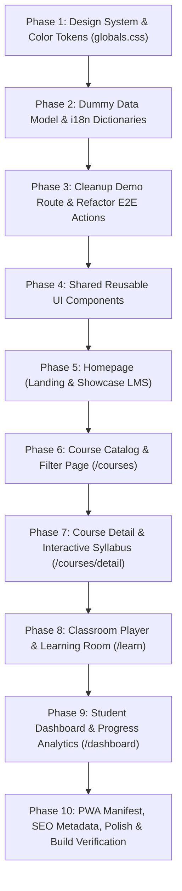

# 🚀 Atomic Phase Plan — Elemes Learning Management System (LMS) Template

> **Objective:** Membangun template website Learning Management System (LMS) modern, modular, fleksibel, responsif, berkinerja tinggi, dan production-ready menggunakan Next.js 16 (App Router), React 19, TypeScript (Strict Mode), Tailwind CSS v4, Serwist PWA, serta Internationalization (i18n).
> **Target Audience:** Dewasa (Mahasiswa, Profesional, Pengajar, Administrator Institusi/Perusahaan)
> **Tujuan Bisnis:** Template universal untuk segala jenis LMS (Sekolah, Kampus, Pelatihan Korporat, Bootcamp, Kursus Mandiri) dengan kemudahan kustomisasi dan preset adaptif.

---

## 📋 Daftar Rencana Fase Atomik (Atomic Phases)

---

### 🔹 Phase 1: Setup Design System LMS di `globals.css`
- **Tujuan:** Menetapkan fondasi visual modern untuk template LMS (Teal & Emerald yang berwibawa, Netral Zinc, Aksen Amber, Dark Mode terkalibrasi).
- **Deliverables:**
  - Update `src/app/globals.css` dengan token warna LMS (`--primary`, `--primary-hover`, `--secondary`, `--accent`, `--card`, `--border`, dsb.).
  - Variabel CSS custom untuk gradient subtle, glassmorphism terkontrol (maksimal 1-2 elemen), dan radius standar.
  - Setup `@theme inline` di Tailwind CSS v4.

---

### 🔹 Phase 2: Pembuatan Model Data Dummy LMS & Sinkronisasi i18n
- **Tujuan:** Menyediakan dataset dummy JSON/TypeScript yang komprehensif, realistis, dan relevan untuk semua jenis instansi pendidikan/pelatihan tanpa ketergantungan API eksternal.
- **Deliverables:**
  - Buat `src/data/lms-data.ts`:
    - Kategori Kursus (Teknologi & Koding, Desain & Kreatif, Bisnis & Manajemen, Data & AI, Pengembangan Diri).
    - Daftar Kursus Lengkap (Thumbnail, Judul, Kategori, Instruktur, Rating, Jumlah Siswa, Durasi, Tingkat Kesulitan, Harga, Silabus multi-modul, Quiz dummy, dsb.).
    - Profil Instruktur & Testimonial Siswa.
    - Data Presets LMS (Pilihan profil untuk: Kampus/Universitas, Bootcamp Kilat, Corporate Academy).
  - Update `src/dictionaries/id.json` dan `src/dictionaries/en.json` secara sinkron (100% key parity untuk lulus unit test `i18n.test.ts`).

---

### 🔹 Phase 3: Cleanup Demo Route & Konsolidasi Server Actions
- **Tujuan:** Mematuhi aturan `GUIDELINE.md` poin 13: "WAJIB HAPUS rute demo (`app/demo-encryption/`) saat mulai pengerjaan web riil".
- **Deliverables:**
  - Pindahkan fungsi enkripsi & obfuscator server action ke `src/lib/security-actions.ts`.
  - Hapus folder rute `src/app/demo-encryption/` (`page.tsx`, `DemoClient.tsx`, `actions.ts`).
  - Perbarui import di `e2e/app.test.ts` agar seluruh pengujian kriptografi tetap berjalan 100% valid tanpa menyisakan rute demo di App Router.

---

### 🔹 Phase 4: Shared Reusable Components
- **Tujuan:** Membangun antarmuka komponen modular dan atomic sesuai standar YAGNI & antislop.
- **Deliverables:**
  - `src/components/navbar.tsx`: Header navigasi sticky, search input, links, mobile sheet drawer, link ke Dashboard & Katalog.
  - `src/components/footer.tsx`: Footer modern terstruktur dengan link navigasi, hak cipta, dan informasi kustomisasi template.
  - `src/components/course-card.tsx`: Kartu kursus visual dengan thumbnail Next.js `Image`, badge kategori, level, rating bintang, durasi, dan harga.
  - `src/components/category-card.tsx`: Kartu kategori interaktif dengan ikon SVG teroptimasi.
  - `src/components/stats-counter.tsx`: Metrik performa platform (kursus, siswa, instruktur).
  - `src/components/button.tsx` & `src/components/badge.tsx`: Komponen tombol dan badge konsisten.

---

### 🔹 Phase 5: Halaman Utama LMS (`src/app/page.tsx`)
- **Tujuan:** Landing page profesional yang menjual keunggulan template LMS dan memikat calon siswa/institusi.
- **Deliverables:**
  - Hero Section interaktif dengan CTA eksplorasi & pencarian kursus instan.
  - Preset Selector (Universitas / Corporate Training / Bootcamp).
  - Kategori Pilihan & Kursus Populer dengan filter tabs.
  - Alur Jalur Pembelajaran Karir (Career Learning Pathways).
  - Fitur Unggulan Template ("Mengapa Elemes LMS?").
  - Testimoni Siswa & Mitra Institusi.
  - CTA Kemitraan & Banner Bergabung.

---

### 🔹 Phase 6: Halaman Katalog & Filter Kursus (`src/app/courses/page.tsx`)
- **Tujuan:** Halaman penjelajahan kursus dengan kapabilitas filtering & sorting lengkap.
- **Deliverables:**
  - Filter interaktif sisi klien: berdasarkan Kategori, Level (Pemula, Menengah, Mahir), Format (Video, Proyek), Harga (Semua, Gratis, Berbayar).
  - Input pencarian real-time dan pengurutan (Terbaru, Rating Tertinggi, Terpopuler).
  - Ringkasan hasil pencarian dengan badge filter aktif.
  - Grid kursus responsif dan empty state informatif jika filter tidak cocok.

---

### 🔹 Phase 7: Halaman Detail Kursus & Silabus (`src/app/courses/detail/page.tsx`)
- **Tujuan:** Informasi mendalam tentang materi kursus, capaian belajar, instruktur, dan silabus terperinci.
- **Deliverables:**
  - Hero overview: Judul, deskripsi, rating, tingkat, total jam, instruktur.
  - Video Preview Player Card yang sticky pada desktop.
  - Silabus Interaktif (Accordion materi & modul dengan durasi dan badge preview).
  - Section "Apa yang Akan Anda Pelajari" (Learning Outcomes checklist).
  - Prasyarat Kursus & Profil Instruktur Lengkap.
  - Ulasan & Testimoni Siswa untuk kursus terkait.
  - Tombol aksi: "Mulai Belajar Sekarang" mengarah ke Classroom Player.

---

### 🔹 Phase 8: Halaman Pembelajaran Interaktif / Classroom Player (`src/app/learn/page.tsx`)
- **Tujuan:** Pengalaman belajar fokus tanpa distraksi (focus learning mode).
- **Deliverables:**
  - Topbar navigasi belajar dengan tombol kembali, nama materi, progress bar persentase penyelesaian, dan navigasi Next/Previous lesson.
  - Area Video Player interaktif dengan kontrol playback kustom (kecepatan 1x/1.5x/2x, volume, resolusi, fullscreen, subtitle).
  - Tab konten pembelajaran: Catatan Materi (Markdown / Code Blocks), Berkas Pendukung (Downloadable Resources), Forum Tanya-Jawab Diskusi, dan Kuis Evaluasi Cepat.
  - Sidebar silabus materi dengan indikator status centang (selesai / sedang aktif / terkunci).

---

### 🔹 Phase 9: Student Dashboard & Analitik Belajar (`src/app/dashboard/page.tsx`)
- **Tujuan:** Dasbor personal siswa untuk memantau kemajuan, sertifikat, dan agenda belajar.
- **Deliverables:**
  - Ringkasan profil siswa dan streak belajar harian.
  - Metrik statistik: Total Kursus Berjalan, Jam Belajar, Sertifikat yang Diperoleh, Rata-rata Skor Kuis.
  - Tab navigasi dasbor: "Sedang Berjalan", "Selesai & Sertifikat", "Tugas Mendatang".
  - Kartu kursus aktif dengan tombol "Lanjutkan Belajar" langsung ke materi terakhir di `/learn`.
  - Rekomendasi kursus lanjutan sesuai minat siswa.

---

### 🔹 Phase 10: Polishing, SEO, PWA & Final Build Verification
- **Tujuan:** Memastikan kesempurnaan performa, aksesibilitas, SEO, responsivitas, dan keberhasilan build produksi.
- **Deliverables:**
  - Update `src/app/manifest.ts` & `src/app/layout.tsx` metadata untuk Elemes LMS.
  - Pengujian `bun test` untuk memastikan semua unit test & e2e test lulus 100%.
  - Pengujian `bun run lint` dan `bun run build` memastikan zero-error & zero-warning.
  - Verifikasi responsivitas pada mobile (375px), tablet (768px), dan desktop (1280px+).
